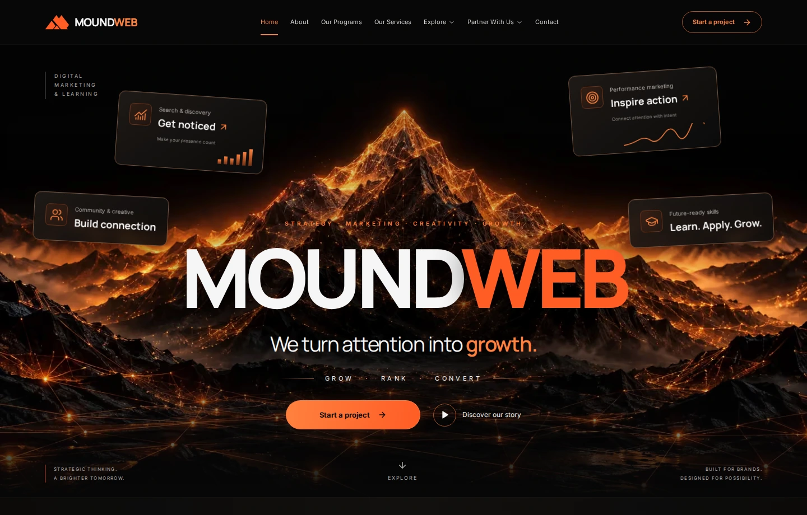

# Visual QA — MOUNDWEB Parts 01–02

Verified on 2026-10-15 against an optimized production build. The supplied Home, About, Our Program, Our Services, Contact Us, and additional wide home hero images were inspected before implementation and compared side by side with actual browser captures. Screenshots are rendered pages, not generated website mockups.

## Results

| Gate                          | Result                                                                                                                                                      |
| ----------------------------- | ----------------------------------------------------------------------------------------------------------------------------------------------------------- |
| Clean dependency installation | `npm ci` passed using the committed lockfile.                                                                                                               |
| ESLint                        | Passed for API and web.                                                                                                                                     |
| TypeScript                    | Passed across API, web, and shared workspaces.                                                                                                              |
| Unit tests                    | 10 passed: 4 content hierarchy, 4 inquiry validation, 1 inherited API, 1 shared contract.                                                                   |
| Production builds             | Shared TypeScript, Express API, and Next.js builds passed. Next generated 31 static outputs.                                                                |
| API compatibility smoke check | Built API returned HTTP 200 and `{status:"ok",service:"moundweb-api"}` at `/api/health`; unknown API path returned 404.                                     |
| Browser suite                 | 30 passed, 0 failed, 0 skipped, 0 flaky; Chromium 141 via Playwright 1.56.1.                                                                                |
| Responsive coverage           | Five approved pages × 375, 768, 1024, 1440, and 1920px = 25 full-page captures. Viewport height: 900px.                                                     |
| Accessibility scans           | 10 axe scans: all five pages at 375px and 1440px, WCAG 2 A/AA and 2.1 AA tags; zero detected violations.                                                    |
| Keyboard behavior             | Skip link, desktop disclosure navigation, FAQ disclosure, mobile focus trap, Escape, focus restoration, and menu-link navigation passed.                    |
| Form behavior                 | Required-field validation, first-error focus, inquiry preselection, local review, escaped text, preserved field values, and no POST submission passed.      |
| Internal links                | 44 unique destinations/fragments passed, including all eleven courses, supporting templates, and partnership pages. Unknown top-level URL returns HTTP 404. |
| Assets                        | All 50 manifest assets returned HTTP 200 with the expected byte length; visible page images loaded at all 25 page/viewport combinations.                    |
| Layout and console            | No horizontal overflow, clipped CTA buttons, page errors, or browser console errors in the 25 responsive checks.                                            |
| Reduced motion                | Content remained visible; the static scene contract and removal of motion passed. No canvas or video was substituted for later 3D scenes.                   |

See [machine-readable results](qa/results.json) for individual test names, duration, environment, and the complete verified destination list. Browser tests retain native PNG screenshots, traces on failure, JSON, and an HTML report locally and in CI artifacts. Committed WebP screenshots below are optimized copies of those actual captures.

## Screenshot index

| Page     | 375px                          | 768px                          | 1024px                          | 1440px                           | 1920px                        |
| -------- | ------------------------------ | ------------------------------ | ------------------------------- | -------------------------------- | ----------------------------- |
| Home     | [Mobile](qa/home-375.webp)     | [Tablet](qa/home-768.webp)     | [Laptop](qa/home-1024.webp)     | [Desktop](qa/home-1440.webp)     | [Wide](qa/home-1920.webp)     |
| About    | [Mobile](qa/about-375.webp)    | [Tablet](qa/about-768.webp)    | [Laptop](qa/about-1024.webp)    | [Desktop](qa/about-1440.webp)    | [Wide](qa/about-1920.webp)    |
| Programs | [Mobile](qa/programs-375.webp) | [Tablet](qa/programs-768.webp) | [Laptop](qa/programs-1024.webp) | [Desktop](qa/programs-1440.webp) | [Wide](qa/programs-1920.webp) |
| Services | [Mobile](qa/services-375.webp) | [Tablet](qa/services-768.webp) | [Laptop](qa/services-1024.webp) | [Desktop](qa/services-1440.webp) | [Wide](qa/services-1920.webp) |
| Contact  | [Mobile](qa/contact-375.webp)  | [Tablet](qa/contact-768.webp)  | [Laptop](qa/contact-1024.webp)  | [Desktop](qa/contact-1440.webp)  | [Wide](qa/contact-1920.webp)  |



## Comparison with the approved references

The comparison evaluated section sequence, relative density, text hierarchy, image placement, card proportions, line lengths, spacing, and the overall composition. It was a visual review, not a pixel-difference score: original artwork, corrected copy, the required course hierarchy, and responsive reflow necessarily change pixels.

| Page     | Preserved composition                                                                                                                                                                                                                                                                                        | Deliberate differences and remaining mismatch                                                                                                                                                                                                                                                       |
| -------- | ------------------------------------------------------------------------------------------------------------------------------------------------------------------------------------------------------------------------------------------------------------------------------------------------------------ | --------------------------------------------------------------------------------------------------------------------------------------------------------------------------------------------------------------------------------------------------------------------------------------------------- |
| Home     | Compact navigation, centered mountain and oversized MOUNDWEB wordmark, floating growth panels, six-service grid, split globe/approach section, measurement panel, testimonial area, landscape CTA, four-column footer. The additional wide hero reference guided the expansive summit and centered wordmark. | Capability labels replace the unverified client strip. Semantic growth labels replace unsupported hero metrics. A two-path programs section reflects the stated business. The testimonial area is an explicit future-content state. The globe and mountain are static.                              |
| About    | Left hero copy/right globe-mountain scene; story plus four values; paired mission/vision image panels; six capabilities; records; benefits; partnership cards; three role cards; landscape CTA.                                                                                                              | Claims and counters are pending. Illustrative role vectors replace purported employee photography. Partnership cards and section spacing allow longer legible copy, so the page is taller than the reference.                                                                                       |
| Programs | Ascent hero with an anonymous learner, path markers and four benefits; category selector; illuminated course groups; learning benefits; centered CTA; two-column FAQ; shared footer.                                                                                                                         | Exactly two categories replace the reference's separate AI department. Six Digital Marketing and five Web Development courses replace its incomplete inventory. Cards use three columns on desktop instead of five cramped cards, increasing page length. Unconfirmed topics and fees remain draft. |
| Services | Summit-path hero with four floating process labels; capability strip; six illustrated service cards; Advertising Coming Soon panel; four benefits; connected process; measurement cards; mountain CTA.                                                                                                       | Website development is excluded as a service. Qualitative measurement labels replace unsupported results. Original art differs in its exact object arrangement, lighting, and mountain topology. Vertical spacing is more generous for real text.                                                   |
| Contact  | Split mountain hero; four contact-method panels; globe/form/landscape composition; four help cards; two partnership cards; FAQ; final landscape CTA and shared footer.                                                                                                                                       | Contact details and hours remain unconfirmed. The form action is Review inquiry with an explicit local-only explanation. A fake schedule-call link is absent. Wider spacing and accessible controls make the page taller than the compact reference.                                                |

Across pages, Manrope and Inter replace lettering embedded in the AI mockups. The mark and live wordmark are consistent. Black/amber composition, orange emphasis, thin warm borders, muted surfaces, restrained glows, and mountain imagery are retained. Decorative density is reduced where it competes with small text. The original generated imagery is intentionally cohesive, not an exact copy of reference pixels.

## Iteration and inspection

- Corrected hero artwork positioning so desktop summits and ascent flags are visible instead of being cut off by cover cropping.
- Kept desktop heading areas dark while letting mountain scenes occupy the right side. At 375px, copy sits above the main landscape detail.
- Corrected compact-footer heading sizes and preserved spaces when mobile line breaks collapse.
- Reflowed grids, partnership panels, footer columns, course labels, and form fields at tablet/phone widths; the mobile form uses 16px controls to avoid input zoom.
- Replaced a broad supporting-page route with explicit static routes after verification detected HTTP 200 on an unknown URL. The final browser run confirms 404 behavior.
- Waited for fonts and visible image decoding before screenshot capture. Initial lazy-image timing issues in the screenshot harness were corrected rather than misreported as production asset failures.
- Inspected full-page desktop captures side by side with all five supplied designs, plus phone hero/section views and intermediate-width captures for reflow and cropping.

## Scope and limits

No required Part 01–02 artwork remains missing. Shared assets are reused intentionally for mission/vision, Advertising Coming Soon, atmospheric treatments, and CTAs; see the [asset manifest](ASSET_MANIFEST.md).

Parts 03 and 04 are not implemented: there is no particle formation, three-impact sequence, explosion, revolving Earth, or orbital simulation. Renderer-ready supporting textures and stable component boundaries are supplied in [the animation handoff](ANIMATION_HANDOFF.md). Scroll effects, parallax, and numeric counters also await their later motion/content work.

This run uses Chromium in a Linux environment. Safari, Firefox, physical-device performance, screen-reader testing, and Core Web Vitals field data have not been measured. Automated axe checks are not a complete accessibility certification. The production build reports roughly 112kB first-load JS for the main informational pages and 140kB for Contact; no Lighthouse score is claimed.

Business backend delivery, admissions, payments, applications, real publishing, verified contact channels, approved legal policies, real outcomes, and content approvals are outside this phase. The contact preview does not send or save entered information. The static site foundation is ready for the next implementation part; this is not a claim that commercial launch requirements are complete.

## Reproduce

```bash
npm ci
npm run verify
npx playwright install chromium
npm run test:browser
```

The browser configuration starts the production server itself. CI uses Node 22 and installs Chromium with system dependencies. The local verification used Node 24.19.0. npm emitted a host-environment `http-proxy` configuration warning, and Playwright emitted a color-environment warning; neither was a lint, build, application, or browser-test failure.
